# Hi there! 👋 I'm Asmaa Hamdy

### 🚀 Senior Frontend Developer | Angular & Ionic | Web & Mobile Applications

I'm a passionate Frontend Developer specializing in building modern, responsive, and user-friendly web and mobile applications.

I enjoy transforming ideas into clean, scalable, and maintainable code, with a strong focus on performance, usability, and exceptional user experiences.

---

### 💻 About Me

- 🔭 Working as a **Frontend Developer**.
- 🌐 Experienced in building modern **Web Applications**.
- 📱 Specialized in developing cross-platform **Mobile Applications**.
- ⚡ Experienced in **Angular, Ionic, TypeScript, and JavaScript**.
- 🎨 Passionate about creating responsive and user-friendly interfaces.
- 🧩 Focused on reusable components and clean code architecture.
- 🌱 Always learning and exploring new technologies.
- 🤝 Open to collaboration and exciting development opportunities.

---

### 🛠️ Languages and Technologies

**Frontend Development**

  

**Mobile Development**

  

**Tools & Technologies**

  

- Angular
- Ionic Framework
- Capacitor
- RxJS
- REST APIs
- SCSS
- Responsive Web Design
- Cross-platform Mobile Development

---

### 📱 What I Do

- Build modern and responsive web applications.
- Develop cross-platform mobile applications for Android and iOS.
- Create reusable and maintainable UI components.
- Integrate RESTful APIs and manage application data.
- Optimize application performance and user experience.
- Build scalable frontend architectures.

---

### 📊 GitHub Stats

  

  

---

### 🔥 GitHub Streak

  

---

### 🤝 Connect With Me

  
  

---

⭐ Thanks for visiting my profile!

**Let's build something great together!** 🚀
